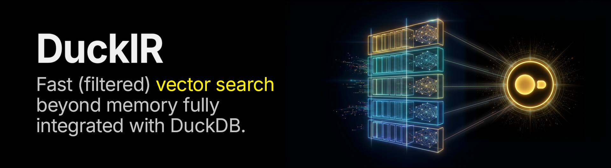

<p align="center">
        
</p>

<h4 align="center">
  A DuckDB extension for Information Retrieval
</h4>
<p align="center">
  Vector Search ✅ | Full Text Search (WIP ⏱️) | Hybrid Search (WIP ⏱️)
</p>

<div align="center">
    <a href="https://duckdb.org/community_extensions/extensions/duckir#compatibility-matrix"></a>
    <a href="https://duckdb.org/community_extensions/extensions/duckir"></a>
    <a href="https://duckdb.org/community_extensions/download_metrics"></a>
    <a href="https://github.com/cwida/DuckIR/blob/main/LICENSE"></a>
    <a href="https://github.com/cwida/DuckIR/stargazers"></a>
</div>

## Why DuckIR?

- **Vector search fully integrated with DuckDB**: Query execution, predicate pushdown, transactional correctness, checkpoints, and crash recovery.
- **Fast vector indexing and search**: Index millions of vectors in seconds and search them in milliseconds.
- **Indexes larger than memory**: We handle creating indexes and searching over embeddings [beyond memory limits](/docs/OUT_OF_CORE.md).
- **Filtered search** on any predicate DuckDB can evaluate.
- **Lightweight maintenance**: Our index [updates](/docs/MAINTENANCE.md) alongside your table and never needs a full rebuild.
- **Morsel-driven parallelism**: Operators work one row group at a time, as DuckDB does.
- **Portable**: Linux (x86, ARM), macOS, Wasm, Windows (x86).
- *FTS and Hybrid Search are WIP*.

> [!WARNING]
> **Status: Alpha.** Production use is not advised. Dropping and recreating indexes might be needed between updates. Check our known [limitations](/docs/LIMITATIONS.md).

## Comparison to [duckdb-vss](https://github.com/duckdb/duckdb-vss)
duckdb-vss is the official DuckDB extension for vector search. Here is how DuckIR compares on 1M 1536-dimensional OpenAI embeddings:

|  | **duckdb-vss**          | **DuckIR**                   | **Improvement**                    |
|------------------------------------------|------------------------:|-----------------------------:|-----------------------------------:|
| Indexing time                            | 250 s                   | 11 s                         | **23× faster**                     |
| Ingestion ¹                               | 590 rows/s            | 10,500 rows/s              | **18× faster**                     |
| Index size on disk                       | 6.29 GB                 | 1.78 GB | **3.5× smaller**             |
| Search ² (recall@10 = 0.95)               | 254 QPS                 | 434 QPS                      | **1.7× faster**                    |
| Filtered Search ³ | 3-16 QPS     | 109-312 QPS    | **10-104× faster**  |
| First query after a restart              | 10.6 s                  | 0.1 s                        | **109× sooner**                    |
| I/O on `CHECKPOINT` ⁴                     | 6.4 GB written          | 0.2 GB written               | **32× less**                   |
|                                          |                         |                              |                                    |
| Index larger than memory                 | No                      | Yes ⁵                         | Out-of-core    |
| Deletes                                  | Manual compaction ⁷ | Self-compacting         | Maintenance-free |
| Workers per search                              | 1       | N ⁶         | Scalable                           |
| Crash recovery                           | Experimental | WAL recovery                 | Robust                             |

> [Tested](/benchmarks/duckir_vs_vss.py) on Zen 4 (12 cores, 3.7 GHz), 64 GB RAM, NVMe, DuckDB v2.0.0. Single-threaded, except index construction (12 threads). DuckIR uses its default `u8` quantization. duckdb-vss runs with `hnsw_enable_experimental_persistence = true`.\
> ¹ One `INSERT` of 10K rows. With `INSERT`s of 100 rows: 200 vs 2,130 rows/s.\
> ² Both cap at ~1,000 QPS due to DuckDB's query planning.\
> ³ 50%, 10%, 1% and 0.1% of rows passing a filter on an `int` column, scattered at random. duckdb-vss' pre-filtering is on (its default).\
> ⁴ After inserting 10K rows.\
> ⁵ [Tested](/docs/OUT_OF_CORE.md#100m-rows-what-to-expect) with 113M 1024-dimensional embeddings in 8 GB of RAM. DuckIR respects DuckDB's `memory_limit`.\
> ⁶ One worker per row group (122,880 rows by default).\
> ⁷ Needs `PRAGMA hnsw_compact_index`. Every checkpoint after a delete rewrites the whole index.

## Usage

### From Hugging Face to DuckIR

1. Start a [DuckDB](https://duckdb.org/installation) v2.0.0 shell instance.

    ```bash
    duckdb
    ```

2. Load the extension. Either:
     - (*Recommended*) Install and load the community extension:

        ```sql
        INSTALL AND LOAD duckir FROM community;
        ```

     - Or build the extension from source (see [DEVELOPMENT.md](DEVELOPMENT.md)), start DuckDB with `-unsigned`, and then load it:

        ```sql
        LOAD '<...>/DuckIR/build/release/extension/duckir/duckir.duckdb_extension';
        ```

3. Create a DuckDB table and the `DUCKIR_VSS` index:

    ```sql
    CREATE TABLE movies (
      title VARCHAR,
      genres VARCHAR[],
      rating DOUBLE,
      embedding FLOAT[1536]
    );
    CREATE INDEX movies_idx
    ON movies
    USING DUCKIR_VSS (embedding)
      WITH (metric = 'cosine');
    ```

4. Insert the data directly from Hugging Face:

    ```sql
    INSERT INTO movies
        SELECT title, genres, imdb.rating, plot_embedding::FLOAT[1536]
        FROM 'hf://datasets/MongoDB/embedded_movies@~parquet/default/train/0000.parquet';
    ```

5. Run (filtered) vector search queries. The filters are evaluated first, pushing down the predicates whenever possible:

    ```sql
    SET VARIABLE q = (
      SELECT embedding
      FROM movies
      WHERE title = 'The Matrix'
    );
    -- If q is NULL, the query runs without the vector search

    SELECT title, genres, rating
    FROM movies
    WHERE list_contains(genres, 'Comedy') AND rating > 7
    ORDER BY array_cosine_distance(
      embedding, getvariable('q')
    )
    LIMIT 5;
    ```

6. Results:

    ```
    The Gods Must Be Crazy         [Action, Comedy]            7.3
    True Lies                      [Action, Comedy, Thriller]  7.2
    Tai-Chi Master                 [Action, Comedy, Drama]     7.3
    The Blind Swordsman: Zatoichi  [Action, Comedy, Crime]     7.6
    The Legend of Drunken Master   [Action, Comedy]            7.6
    ```

### Vector Index Creation

Create a `DUCKIR_VSS` index on your table to speed up vector search queries. The
index automatically [updates](/docs/MAINTENANCE.md) itself when rows are
inserted into or deleted from the underlying table. Both empty and non-empty tables
are supported.

Configure the index using the `CREATE INDEX` statement's `WITH` clause. The
index options cannot be modified after index creation. Drop and recreate the
index instead.

```sql
CREATE INDEX t1_idx
ON t1 USING DUCKIR_VSS (embedding)
WITH (metric = 'l2sq', quantization = 'f32');
```

Available index options:

- `metric`
  - `'l2sq'` (*default*; squared Euclidean distance, optimizes `array_distance`)
  - `'cosine'` (cosine similarity, optimizes `array_cosine_distance`)
- `quantization`: The precision of the embeddings stored inside the index.
  - `f32`: full precision, no compression.
  - `u8`: *default*; scalar quantization, 1 byte per dimension, ×4 compression; ~1% quality loss relative to `f32`.
  - `u4`: SAQ, 4 bits per dimension, ×8 compression; needs at least 64 dimensions; 0.5-3% quality loss relative to `u8` in most embedding datasets (Cohere, MXBAI, OpenAI, Jina).
- `n_probe`: Controls the effort spent during vector search: higher values increase recall, but also increase search latency. This `n_probe` index option is remembered by the index. You can override it at search time using `duckir_vss_n_probe` (see below).
  - `[0, 2147483647]`. *Default* is `24`. This is per row group, which typically has ~480 clusters. Set `n_probe` to `0` to run a brute force search.
- `seed`
  - `[-2147483648, 2147483647]`. *Default* is random.
- `cluster_sketches`: Whether the index keeps a 1-bit sketch of every embedding, which makes searches faster when the index does not fit in memory (see [Out-of-Core](/docs/OUT_OF_CORE.md#pruning-via-1-bit-rabitq-sketches)).
  - `true` (*default*) or `false`.

### Vector Search

The index is used for queries of the form:

```sql
SELECT *
FROM t
[WHERE <predicate>]
ORDER BY <distance_function>(embedding, q) [ASC]
LIMIT k [OFFSET o]
```

- `t`: Can be a table, view, or CTE.

- `OFFSET o`: The index searches the `k + o` nearest neighbors and skips the first `o` results.

You can set the number of clusters to probe per search using `SET duckir_vss_n_probe = 48`. Note that this will overwrite the value for subsequent searches. You can reset it by running: `RESET duckir_vss_n_probe;`.

**Threading**: We use all the threads available in DuckDB. To set the number of threads, use `SET threads = 1;`.

### Filtered Vector Search

We support arbitrary predicates: **any predicate DuckDB can evaluate on the table's columns**, including but not limited to: conjunctions, disjunctions, comparisons, `IN`, `NOT IN`, `BETWEEN`, `LIKE`, `EXISTS`, `NOT EXISTS`, expressions over a column, volatile predicates, filters over `embedding[i]`, subqueries as filters, `IN (<subquery>)` (SEMI JOINs), and `list_contains`.

Index search also kicks in if the predicate is rewritten as a `HASH JOIN` (e.g., `WHERE id IN (SELECT item_id FROM purchases)`), even if it goes out-of-core or the join key is compressed.

See [our limitations doc](/docs/LIMITATIONS.md) for the query shapes we don't optimize.

### Bulk Queries

You can get better performance by issuing many queries at once as a `LATERAL JOIN`. See our [optimization guide](/docs/OPTIMIZATION_GUIDE.md#bulk-queries-lateral-join) for more information.

### Index Metadata

Execute `CALL duckir_vss_index_info();` to print metadata about all vector indexes. This includes each index's in-memory size.

### Writing Queries

A list literal is the simplest way to write the query vector:

```sql
SELECT id
FROM t
ORDER BY array_distance(
  embedding,
  [0.2502, 0.7944, ..., -0.5050]::FLOAT[d]
)
LIMIT 10;
```

However, by doing so, your query throughput will be capped by DuckDB's query planning. See our [optimization guide](/docs/OPTIMIZATION_GUIDE.md#highest-query-throughput) for more information and alternatives to get the highest query throughput.

## Our Secret Sauce

When you create a `DUCKIR_VSS` index, we internally create one local index per DuckDB row group (by default, one per 122,880 rows). This enables lightweight maintenance, morsel-driven parallelism, and pushing down SQL predicates onto the vector search.

To learn more about the techniques inside the `DUCKIR_VSS` index, check out the following docs:

- [Vector Index](/docs/VECTOR_INDEX.md)
- [Maintenance](/docs/MAINTENANCE.md)
- [Persistence](/docs/PERSISTENCE.md)
- [Out-of-Core](/docs/OUT_OF_CORE.md)
- [Optimization Guide](/docs/OPTIMIZATION_GUIDE.md)

## Limitations

See [LIMITATIONS.md](/docs/LIMITATIONS.md)

## Roadmap

- Q1'2027: Full Text Search and Hybrid Search with local indexes.
- Q1'2027: Beta release.
- Q2'2027: Integration in [DuckLake](https://ducklake.select/).

## Contributing
We're committed to improving the extension and we appreciate your feedback. You can help out by [reporting bugs](https://github.com/cwida/DuckIR/issues/new?labels=bug), submitting fix [pull requests](https://github.com/cwida/DuckIR/pulls), and [suggesting features](https://github.com/cwida/DuckIR/issues/new?labels=enhancement).

## Acknowledgements

The extension would not be possible without the underlying technologies and the lessons learned from other extensions.

- **[Vector search research](/docs/VECTOR_INDEX.md)**: We take inspiration and ideas from many vector search research papers (e.g., [PDX](https://github.com/cwida/PDX), [SuperKMeans](https://github.com/cwida/SuperKMeans), [RaBitQ](https://github.com/VectorDB-NTU/RaBitQ-Library), [SPFresh](https://arxiv.org/abs/2410.14452), [SAQ](https://arxiv.org/abs/2509.12086)).
- **[duckdb-vss](https://github.com/duckdb/duckdb-vss)**: We've taken inspiration from the VSS interface, and we reuse parts of the VSS extension's code.

## License

The extension is licensed under the [MIT license](LICENSE).
