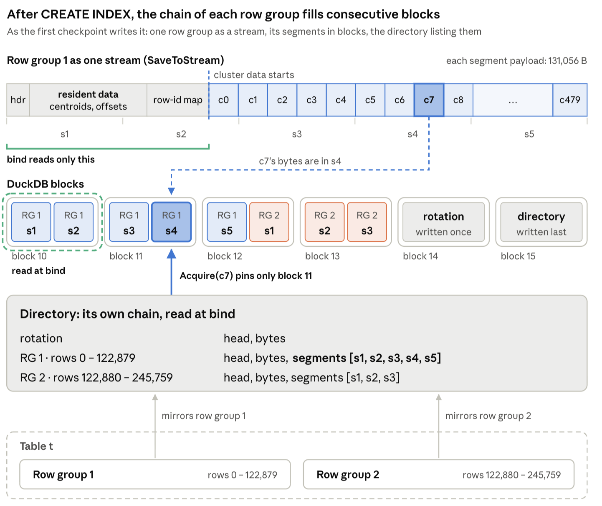

# Persistence

Our vector index is saved with the database file. DuckDB's checkpoints persist the index, and the first query that uses it after the database opens loads the (small) part of the index that must stay in memory.

A checkpoint only rewrites the local indexes that changed since the previous checkpoint, one at a time. Changes committed after the last checkpoint are replayed from DuckDB's WAL into the table, and the indexes catch up on their next use.

## Our Data Layout on Disk

After a `CREATE INDEX`, we store chains of DuckDB segments per local index. A directory (stored in its own chain of segments) keeps pointers to each local index's chain. 

        

Any change in the index only touches the chain of its local index. 

## Keeping the Local Indexes in Sync
When the index is loaded, it is validated against the table, so it never misses committed rows or returns deleted ones, even when DuckDB could not replay its log into the index ([duckdb#26112](https://github.com/duckdb/duckdb/issues/26112)). If the database closes without a checkpoint right after `CREATE INDEX` (for example, after a crash), the index is built again from the table the first time it is used. 

## Inserts and Deletes

`INSERT`s trigger a row group materialization on the next sync. This might seem bad at first sight. But note that, unless a compaction happens, only the active row group (the last one) is materialized in memory during a sync.

`DELETE`s only touch resident data (tombstones). The persisted chain keeps deleted rows, and every bind reconciles the index with the table. When deletes pass 10% of the row group's rows, we mark the row group as dirty, so that it is rewritten in the next checkpoint.

Check [PR#35](https://github.com/Noorts/DuckIR/pull/35) for a more detailed explanation of persistence in DuckIR.